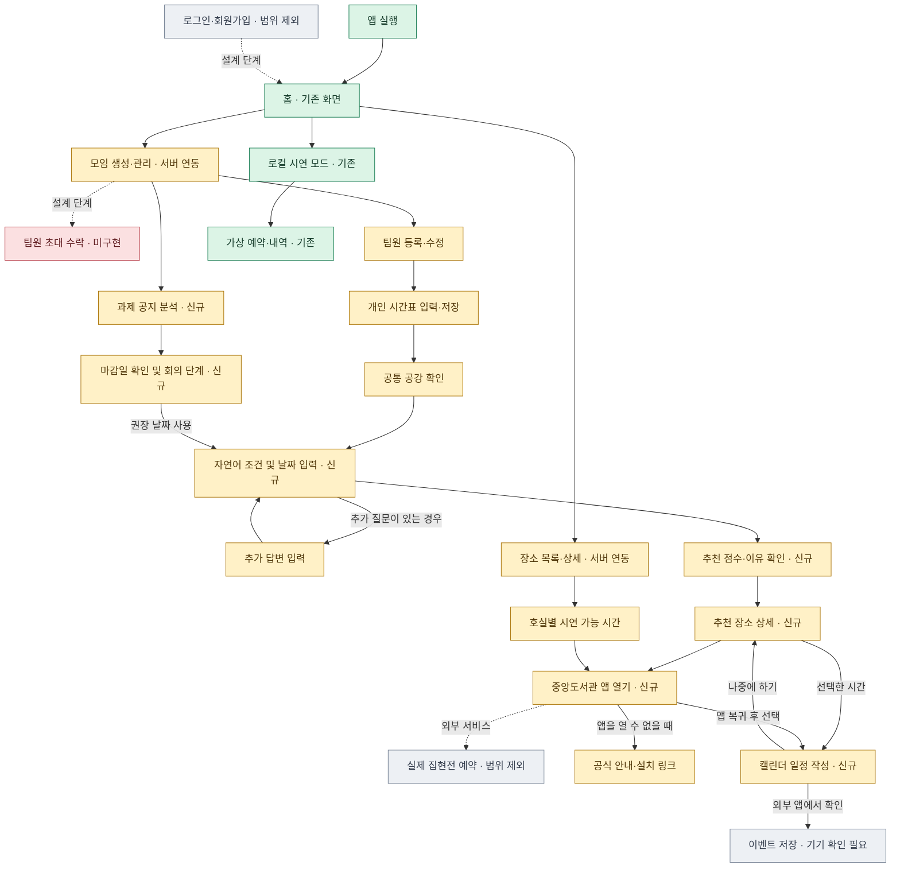

# KW Meet 앱 플로우

🟢 기존 시연 또는 실행 검증 완료 · 🟡 구현 후 Android 화면 검증 필요 · 🔴 미구현 · ⚪ 범위 제외 또는 외부 확인 필요

| 기능 | UI 구현 | API 연동 | 테스트 | 비고 |
|---|---|---|---|---|
| 홈 화면 | 기존 | 모임 목록·최근 모임 공강 | 기존 Android 시연, 새 연결 HTTP 검증 | 앱은 홈에서 시작 |
| 모임 관리 | 기존 UI에 서버 입력 상태 추가 | 목록·상세·생성·이름 수정·삭제 | HTTP 조회·수정·삭제 통과 | 기본 팀원 건우·승균·휘서 |
| 팀원 관리 | 기존 | 추가·이름 수정·삭제 | HTTP 통과 | 서버 모드 1~12명 |
| 시간표 입력 | 기존 그리드 | 팀원 PATCH·모임 재조회 | 시간표 키 저장·복원 HTTP 통과 | 월~금 6교시 |
| 공통 공강 | 기존 그리드 | 공강 블록과 참석자 ID | 30칸·전원 공강 수·멤버 ID HTTP 통과 | 서버의 순위와 수준 사용 |
| 장소·호실 | 기존 + 시연 시간표 | 장소와 호실 목록·상세·날짜 조회 | HTTP 통과 | 현황은 시연 점유 값 |
| 자연어 입력 | 신규 | conditions | 테스트 응답의 질문·답변, 미설정 503 확인 | 실제 Claude 미호출 |
| AI 추천 결과 | 신규 | recommendations | 날짜, 후보, 점수, 이유, 빈 결과, 422 확인 | 서버 계산과 테스트용 AI |
| 중앙도서관 연결 | 신규 | Android 앱 실행·공식 안내 링크 | 패키지 출처 확인, 실기기 미검증 | 설치된 앱과 예약 화면 확인 필요 |
| 캘린더 등록 | 신규 | Android INSERT, Google Calendar 웹 양식 | KST 변환·OS 인텐트 대상 확인 | 외부 앱에서 사용자 저장 필요 |
| 과제 공지 분석 | 신규 | assignments 목록·상세·POST·마감일 PUT | 테스트 응답 및 마감일 갱신 HTTP 통과 | 단계 날짜 범위는 재계산 없이 추천에 전달 |
| 로그인·초대 수락 | 없음 | 범위 제외 | 해당 없음 | 인증·계정 연결 서버 필요 |

점선은 검증 대상 앱 내부에서 완료되지 않는 설계 또는 외부 서비스 단계입니다. 초록색 홈은 기존 MVP 시연 이력을 기준으로 표시했습니다. 서버 모드의 홈 API는 HTTP로 확인했습니다.
