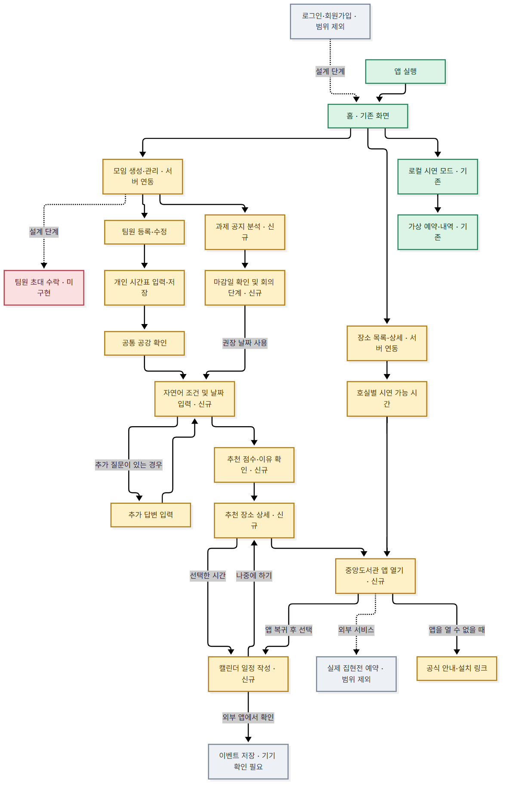

# TeamPlus 프론트엔드 개발 현황 및 API 연동 명세서



[컬러 앱 플로우와 기능별 구현 상태표](frontend-flow.md) · [PR 개발 이력](frontend-changelog.md)

## 프로젝트 개요

KW Meet은 팀원의 주간 시간표를 바탕으로 모임 시간과 장소를 찾는 Android 앱입니다. 2026-11-14 작업은 Main의 프론트엔드 MVP, 백엔드·AI API와 [팀 앱 설계도](app_flow.png)를 기준으로 진행했습니다. [개발 이슈 #9](https://github.com/SeungGyunLee/TeamPlus/issues/9)

## 기술 스택과 디렉터리

React Native 0.86.3, React 19.2.3, TypeScript, Expo SDK 57, Expo Router, NativeWind, Reanimated, AsyncStorage를 사용합니다. Android 외부 앱과 캘린더에는 Expo IntentLauncher를 사용합니다. FastAPI와 SQLite는 기존 서버 구성을 사용합니다.

| 위치 | 담당 |
|---|---|
| `frontend/app/(tabs)/` | 홈, 장소 탐색, 설정과 로컬 가상 예약 이력 |
| `frontend/app/group/`, `timetable/`, `availability/`, `place/` | 기존 모임·시간표·공강·장소 화면 |
| `frontend/app/recommend*/`, `calendar.tsx` | 조건·날짜 입력, 추천 결과와 상세, 일정 추가 |
| `frontend/app/assignments/`, `assignment/` | 과제 공지 입력, 분석 이력과 회의 단계 |
| `frontend/src/data/api.ts` | camelCase 요청·응답 타입, API 주소, 지연·오류 처리 |
| `frontend/src/state/` | 화면 조회 및 취소, 변경 요청, 추천 결과 전달 |
| `frontend/src/components/` | 기존 테마와 UI, 서버 그룹·호실·외부 앱 연결 |
| `frontend/plugins/` | Android 중앙도서관 앱 패키지 조회 등록 |
| `frontend/tests/` | 기존 도메인 검사와 로컬 HTTP 통합 검증 |

## 화면과 이용 흐름

홈에서 모임을 생성하고 팀원과 시간표를 관리합니다. 모임과 공강 화면에서 조건 입력으로 이동합니다. 시작일과 종료일을 선택한 뒤 서버가 추가 질문을 반환하면 답변을 이어 보냅니다. 조건 해석을 완료하면 해당 객체로 추천을 요청합니다. 결과는 서버가 보낸 점수, 시간, 추천 이유, 참석자, 조건 충족 및 일정 충돌을 표시합니다.

추천 상세에서 장소 정보와 호실을 볼 수 있습니다. 중앙도서관 앱에서 실제 예약 가능 여부를 확인합니다. 캘린더 일정 작성은 선택 기능입니다. 앱이 날짜, 시작·종료 시간 및 위치를 외부 일정 작성 화면에 채웁니다. 사용자가 거기서 저장합니다. [중앙도서관 공식 안내](https://www.kw.ac.kr/ko/department/affiliated03.jsp) · [공식 Android 앱](https://play.google.com/store/apps/details?id=idoit.slpck.kwangwoon) · [Android 일정 작성 인텐트](https://developer.android.com/guide/components/intents-common#AddEvent)

모임 관리의 과제 공지 분석에서 제목과 공지를 제출하고, 추출 마감일과 출처, 중간 일정, 단계별 목적·우선순위·날짜 범위를 확인합니다. 사용자가 마감일을 확인하거나 고치면 서버가 범위를 갱신합니다. 단계의 권장 기간으로 추천 화면을 열 수 있습니다.

## 기존 기능과 이번 변경

[#4](https://github.com/SeungGyunLee/TeamPlus/pull/4)의 홈·탭·모임·팀원·주간 시간표·공통 공강·공간 탐색과 기존 테마를 재사용합니다. 가상 예약은 서버 주소를 비운 기기 내 시연 모드에서 이용할 수 있습니다. 서버 모드는 공식 도서관 앱 이동을 사용합니다.

이번 작업은 기존 운영 화면의 서버 연동과 자연어 추천, 과제 공지 분석, 외부 앱 이동을 추가했습니다. 새 모임은 건우·승균·휘서로 생성하고, 서버 모드에서는 팀원 수를 1~12명으로 제한합니다.

## 백엔드 API

아래 경로 앞에는 `/api`가 붙습니다. 요청과 응답의 선언은 `frontend/src/data/api.ts`에서 확인할 수 있습니다. [백엔드 API 문서](../backend/README.md)

| 화면 | 메서드·경로 | 주요 전송 및 화면 처리 |
|---|---|---|
| 홈·모임 관리 | GET/POST `/groups`, GET/PATCH/DELETE `/groups/{id}` | `name`, `memberNames`로 생성, 새 ID로 상세 이동 |
| 팀원 | POST `/groups/{id}/members`, PATCH/DELETE `/groups/{id}/members/{memberId}` | 이름 또는 `busy` 전체 목록 전송 후 서버 상세 갱신 |
| 공강 | GET `/groups/{id}/availability` | `fullCount`, `blocks`, `level`, 참석자 ID를 기존 그리드에 매핑 |
| 장소 | GET `/places`, `/places/{placeId}` | 동일 서버 데이터로 목록, 장소 상세 및 추천 상세 표시 |
| 호실 | GET `/rooms`, `/rooms/availability?date=YYYY-MM-DD` | 서버 호실·시연 시간 상태를 날짜별 표시 |
| 조건 | POST `/groups/{id}/conditions` | `text`를 보내고 `type`과 `question`을 처리 |
| 추천 | POST `/groups/{id}/recommendations` | `conditions`, `dateFrom`, `dateTo` 전송. 후보 점수·상태·근거 표시 |
| 과제 | GET/POST `/groups/{id}/assignments`, GET `/groups/{id}/assignments/{assignmentId}` | `title`과 `noticeText` 전송, 목록과 단계 상세 조회 |
| 마감일 | PUT `/groups/{id}/assignments/{assignmentId}/deadline` | `finalDeadline` 제출 후 날짜 범위 재조회 |

`busy`의 `0-0`은 월요일 1교시입니다. 추천은 한국 시간으로 오늘부터 29일 뒤까지 선택할 수 있습니다. API의 `detail`을 오류 메시지로 표시하고 입력을 유지합니다. 서버 요청 중 같은 화면의 변경을 중복 실행하지 않도록 제어합니다. HTTP 422와 Claude 미설정 503에는 원인에 맞는 안내를 표시합니다.

## 상태 관리와 저장

`EXPO_PUBLIC_API_URL` 설정 시 모임·팀원·시간표는 서버 원본을 사용합니다. 화면 복귀와 저장 후 서버를 다시 조회하며, 다른 화면으로 이동하면 진행 중인 조회를 취소합니다. 추천 응답은 메모리에 보관하여 결과와 상세가 같은 응답을 참조합니다. 앱을 다시 시작한 뒤에는 새로 추천을 요청해야 합니다.

기존 AsyncStorage 데이터는 기기 내 시연 모드에 남아 있고 테마 설정은 두 모드에서 사용합니다. 서버 연결 오류는 화면에 표시합니다. 기존 기기 데이터를 새 서버 DB로 가져오려면 별도 이전 절차가 필요합니다.

`EXPO_PUBLIC_TEST_AI=1`은 테스트 서버를 접속할 때 화면에 테스트 응답을 표시합니다. 키는 서버에서 관리합니다. 검증 서버는 `frontend/tests/fixture_server.py`에서 실제 FastAPI 앱과 메모리 SQLite를 사용하고 기존 테스트용 LLM만 주입합니다.

## 실행과 검증

`frontend/.env.example`의 서버 주소를 복사해 `frontend/.env.local`에 설정한 뒤 Expo를 시작합니다. 에뮬레이터의 `10.0.2.2`는 개발 PC의 루프백 주소입니다. 실제 기기는 해당 서버에 도달할 수 있는 주소가 필요합니다.

API 확인에는 저장소 의존성을 설치한 Python 환경을 사용합니다.

```powershell
cd backend
$env:TEAMPLUS_TEST_AI = '1'
python -m uvicorn fixture_server:app --app-dir ../frontend/tests --host 127.0.0.1 --port 8000
```

별도 터미널에서 같은 명령으로 `TEAMPLUS_TEST_AI=0`과 포트 `8001`을 사용하면 Claude 미설정 오류를 재현할 수 있습니다. 프론트에서 `pnpm typecheck`, `pnpm test`, `pnpm exec tsx tests/api.integration.ts`, `pnpm bundle:android`를 실행합니다.

| 검사 | 결과 |
|---|---|
| TypeScript | 통과 |
| Oxlint 기본 정확성 규칙, 테스트 도구 Ruff | 통과 |
| 기존 프론트 단위 테스트 | 12개 통과 |
| 로컬 FastAPI 통합 테스트 | CRUD, 시간표, 장소, 질문·추천·과제 및 오류 응답 통과 |
| 기존 백엔드 테스트 | 96개 통과 |
| Android JS 번들 | 생성 성공 |
| Expo 온라인 의존성 검사 | 저장소 기존 SDK 57 패키지 5개에 최신 패치 경고 |
| Android 화면 조작 | 에뮬레이터 부팅 확인. Windows 화면 캡처 시간 초과와 Metro 시작 명령 차단으로 미검증 |
| 실제 Claude, 도서관 예약, 캘린더 계정 저장 | 미검증 |

추가 React 분석 규칙은 기존 AppProvider 초기화, Reanimated 공유 값 갱신, 시연 예약 화면의 현재 시각 조회를 지적합니다. 이 규칙은 저장소의 필수 검사로 설정돼 있지 않습니다.

## 미구현과 후속 작업

인증, 초대 수락, 계정 연결과 개인별 편집 권한은 서버 지원이 필요합니다. 실제 집현전 예약 및 완료 상태는 중앙도서관 앱에서 처리합니다. 기기 검증에서는 설치된 도서관 앱 열기, 캘린더 양식의 KST 날짜·위치, AI 입력부터 결과까지의 터치를 확인합니다. 배포 서버와 Claude 키가 준비되면 실제 응답과 장애 복구를 확인합니다.

이번 개발 이슈와 PR은 [개발 이력](frontend-changelog.md)에서 확인할 수 있습니다.
