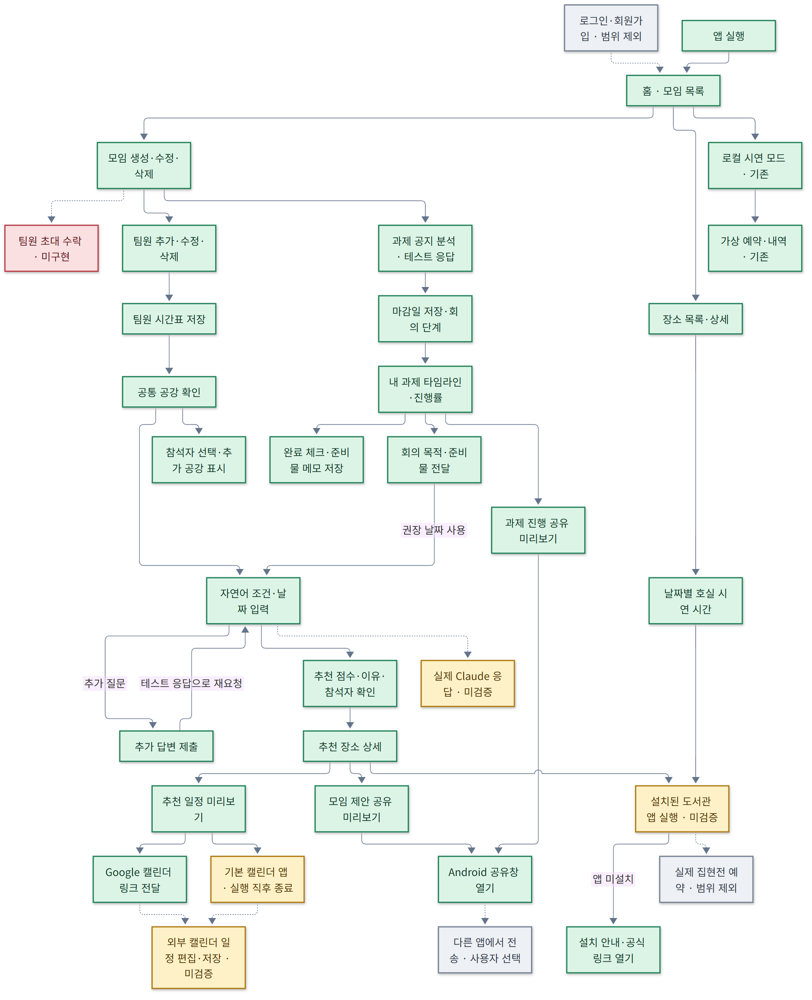
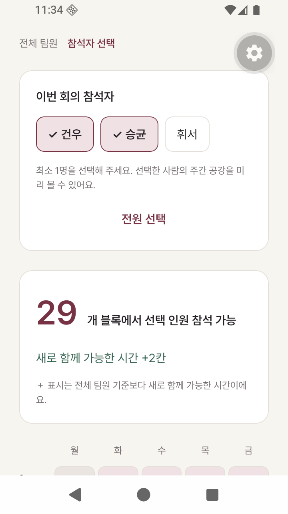
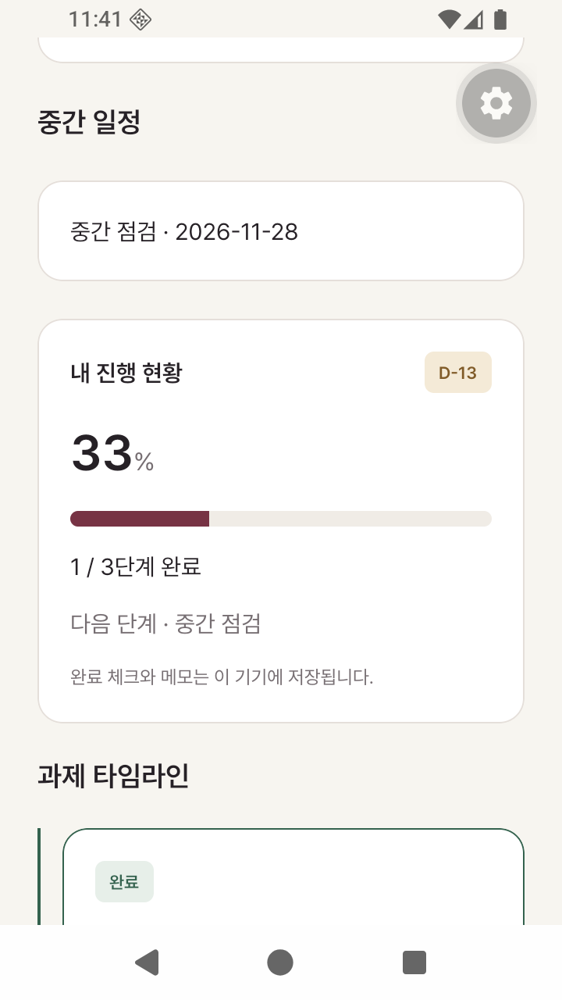
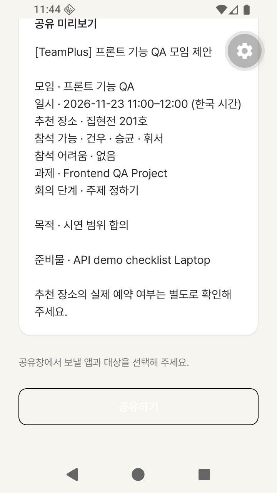
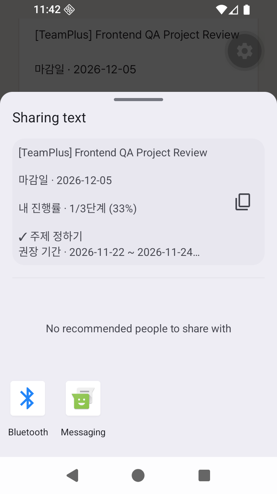

# 공강 시뮬레이션·과제 타임라인·공유

최신 `main`의 API 연동 화면과 수정 와이어프레임을 바탕으로 프론트엔드 기능을 확장했습니다. 이슈 [#13](https://github.com/SeungGyunLee/TeamPlus/issues/13), [#14](https://github.com/SeungGyunLee/TeamPlus/issues/14), [#15](https://github.com/SeungGyunLee/TeamPlus/issues/15)에 대응합니다.



초록색은 Android 화면 확인 또는 기존 시연 완료, 노란색은 추가 검증 필요 또는 실행 실패, 빨간색은 미구현, 회색은 외부 서비스·범위 제외 단계입니다. 이번 세 기능과 Android 공유창 호출은 화면에서 확인해 초록색으로 반영했습니다.

## 참석자 선택 공강 시뮬레이션

공통 공강 화면의 `전체 팀원 / 참석자 선택`에서 사용할 기준을 고릅니다. 참석자 선택은 전원으로 시작하며 최소 1명을 유지합니다. 선택 인원에 맞춰 30개 주간 수업 블록의 인원, 명단, 전원 공강 수와 인원순 목록을 계산합니다. 전체 팀원일 때보다 새로 전원 참석이 가능한 칸에 `＋`를 표시합니다. `전원 선택`으로 복원합니다.

`selectedAvailability()`는 기존 공강 응답의 `availableMemberIds`와 `unavailableMemberIds`를 선택 ID와 대조합니다. API 연결이 없는 시연 모드는 기존 `rankedAvailability()` 결과를 같은 형식으로 사용합니다. 원래 모임과 팀원 시간표는 계산 입력으로 사용합니다.

장소 추천 API는 전체 모임을 기준으로 합니다. 화면의 `전체 팀원으로 장소 추천` 버튼은 이 기준을 명시합니다. 시간표 블록은 기존 월~금 90분 수업 단위이며, 추천 장소의 한 시간 예약 단위와 각각의 화면에서 표시합니다.

## 내 과제 타임라인

과제 분석 결과의 마감일 카드와 중간 일정을 유지하면서 회의 단계에 타임라인, 한국 시간 기준 D-day, 내 진행률, 다음 미완료 단계를 추가했습니다. 각 단계에는 완료 체크와 최대 1,000자의 준비물 메모가 있습니다. 서버가 제외한 선택 단계는 진행률에서 제외합니다. 과거 권장 기간과 날짜가 없는 단계도 상태에 맞춰 표시합니다.

`stageKey()`는 단계의 순서·이름·목적·필수 여부로 진행 상태를 연결합니다. 마감일 변경으로 권장 기간이 다시 배치돼도 같은 단계의 완료 체크와 메모가 유지됩니다. `timelineSummary()`가 진행률, 다음 단계와 D-day를 계산합니다. 권장 기간은 서버가 반환한 값을 표시합니다.

`ProgressRepository`는 AsyncStorage에 서버 주소·모임 ID·과제 ID별로 저장합니다. 저장을 직렬화해 빠른 연속 입력의 순서를 유지합니다. 손상된 데이터는 읽기 오류로 알리고, 저장 실패 시 화면의 최신 편집 내용을 다시 저장할 수 있습니다. `useProjectProgress()`는 화면의 진행 상태와 저장·복원·재시도를 연결합니다. 완료와 메모는 해당 기기의 개인 진행 현황입니다.

## 공유 미리보기

추천 장소 상세의 `모임 제안 공유`는 날짜, 한국 시간, 장소, 참석 가능·어려운 명단을 정리합니다. 과제에서 추천을 시작하면 `RecommendationProvider`의 선택적 `context`에 과제명·회의 단계·목적·준비물을 함께 전달합니다. 기존 모임 화면에서 시작하는 추천도 그대로 사용할 수 있습니다.

타임라인의 `과제 진행 공유`는 마감일, 내 진행률과 활성 단계의 기간·완료 상태·메모를 정리합니다. `meetingShareDraft()`와 `projectShareDraft()`가 각각 양식을 만들고 `shareMessage()`가 실제 전송할 문구를 생성합니다. 공유 화면에서 제목·목적·준비물을 수정하고 정확한 문구를 확인합니다.

`Share.share()`로 Android 공유창을 엽니다. 사용자가 앱과 대상을 선택합니다. Android의 반환 값으로 실제 메시지 전송 여부를 판정하지 않으며, 전송 완료 표시를 만들지 않습니다. 모임 메시지에는 실제 예약 여부를 확인할 안내가 포함됩니다.

## 코드 위치

| 파일 | 역할 |
|---|---|
| `app/availability/[id].tsx` | 참석자 선택과 공강 표·명단·추가 공강 표시 |
| `src/domain/collaboration.ts` | 공강 투영, 단계 식별, 진행률, 공유 문구 |
| `src/data/progressRepository.ts` | 진행 상태 검증과 직렬 저장·복원 |
| `src/state/useProjectProgress.ts` | 화면 편집과 저장·실패 재시도 |
| `src/components/ProjectTimeline.tsx` | 타임라인·체크·메모·추천 및 공유 이동 |
| `src/state/RecommendationProvider.tsx` | 추천 결과와 선택적 과제 맥락 |
| `src/state/ShareProvider.tsx`, `app/share.tsx` | 공유 초안과 편집 가능한 미리보기·OS 공유창 |
| `tests/collaboration.test.ts` | 새 기능의 계산·저장·공유 회귀 검사 |

## 자동 검사

프론트 폴더에서 실행합니다.

```powershell
node node_modules/typescript/bin/tsc --noEmit
node node_modules/tsx/dist/cli.mjs --test tests/*.test.ts
node node_modules/tsx/dist/cli.mjs tests/api.integration.ts
node node_modules/expo/bin/cli export --platform android --output-dir dist/android --max-workers 1
```

단위 검사는 기존 12개와 신규 10개입니다. 신규 검사는 참석자 교집합과 원본 보존, 전체 인원 복원, 선택한 팀원 삭제 후 복원, 순위, 마감일 변경과 단계 유지, 빈 단계·과거 마감일, 저장 범위 분리, 연속 저장·실패 복구, 손상 데이터 보존, 과제 맥락과 공유 문구를 검증합니다. 기존 HTTP 통합 검사는 로컬 테스트 서버 두 개를 사용합니다. 실행 방법은 `../../docs/frontend.md`를 참고합니다.

실제 Claude 응답, 설치된 도서관 앱에서의 예약과 Google 계정 일정 저장은 각각 후속 검증 대상입니다.

## 2026-11-22 Android 화면 검증

Windows PC의 Android API 36 에뮬레이터와 Expo Go에서 새 화면을 직접 조작했습니다. 로컬 FastAPI 테스트 서버에 별도 QA 모임·시간표·과제를 준비하고 AI는 기존 합의에 따라 테스트용 응답을 사용했습니다.

| 항목 | 확인한 결과 |
|---|---|
| 참석자 선택 | 전체 3명 공강 27칸에서 휘서를 제외한 2명 기준 29칸으로 변경, 추가 공강 2칸과 `＋` 표시 |
| 선택 보호·복원 | 마지막 1명은 선택 해제 불가, 전원 선택 시 27칸으로 복원 |
| 타임라인 | 1단계 완료 후 33%, 다음 단계가 중간 점검으로 변경 |
| 저장·재실행 | `API demo checklist` 메모와 완료 체크를 저장하고 앱 프로세스를 종료·재실행해 복원 확인 |
| 마감일 수정 | 12월 4일에서 5일로 저장 후 D-12에서 D-13으로 변경, 33%와 메모 유지 |
| 과제 진행 공유 | 수정한 제목, 마감일, 진행률과 메모가 Android 공유창에 표시 |
| 추천 맥락 전달 | 주제 정하기에서 11월 22~24일로 추천, 공유 미리보기에 과제명·단계·목적·준비물 자동 표시 |
| 모임 공유 | 11월 23일 11~12시, 집현전 201호, 참석자 명단과 수정한 준비물이 공유창에 표시 |
| 취소 후 복귀 | 공유창을 닫은 뒤 편집한 미리보기로 정상 복귀 |

선택된 팀원이 다른 화면에서 삭제되는 경우에도 남은 팀원 중 유효한 선택으로 복원하도록 보완했고 회귀 검사에 포함했습니다. 타입 검사와 단위 검사 22개, 기존 HTTP 통합 검사를 통과했습니다. Android JS 번들도 생성됐습니다. Android 공유창의 앱 선택 이후 실제 메시지 발송은 사용자가 수행합니다.

| 참석자 선택 | 저장·복원한 진행 현황 |
|---|---|
|  |  |

| 모임 공유 미리보기 | Android 공유창 |
|---|---|
|  |  |
